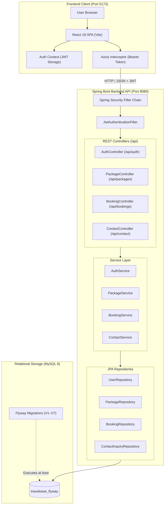

# TravelEase — Travel Package & Tour Reservation Platform

[](https://spring.io/projects/spring-boot)
[](https://react.dev/)
[](https://vitejs.dev/)
[](https://www.mysql.com/)
[](https://flywaydb.org/)
[](https://www.oracle.com/java/)
[](LICENSE)

**TravelEase** is a full-stack web application designed for browsing, reserving, and managing curated holiday travel packages across India. Built with a responsive **React (Vite)** single-page application, a structured **Spring Boot 3** REST backend with **Spring Security** and **JWT authentication**, and a **MySQL 8** database versioned using **Flyway migrations**.

---

## Table of Contents

- [Features](#features)
  - [Customer Experience](#customer-experience)
  - [Administrative Features](#administrative-features)
- [Technology Stack](#technology-stack)
- [System Architecture](#system-architecture)
- [Project Directory Structure](#project-directory-structure)
- [Database Setup](#database-setup)
- [Getting Started](#getting-started)
  - [Prerequisites](#prerequisites)
  - [Backend Setup (Windows)](#backend-setup-windows)
  - [Frontend Setup (Windows)](#frontend-setup-windows)
- [REST API Reference](#rest-api-reference)
- [Security Architecture](#security-architecture)
- [Testing & Quality Assurance](#testing--quality-assurance)
- [Future Enhancements](#future-enhancements)
- [Author & License](#author--license)

---

## Features

### Customer Experience
- **Interactive Tour Catalog**: Browse handcrafted itineraries (Goa Beach Escape, Manali Mountain Getaway, Jaipur Royal Heritage, and Kerala Backwater Bliss) with comprehensive itineraries, photography, inclusions, and exclusions.
- **Server-Verified Booking Engine**: Reserve tour dates and guest counts with strict server-side rate calculation (`basePrice * travelers`) preventing client tampering.
- **Reservation Workflow**: Bookings are immediately created in `PENDING` status with `PENDING` payment status, ready for review and confirmation by travel coordinators.
- **My Bookings Dashboard**: Review active and historical reservations, track status updates, and view fare breakdowns.
- **Self-Service Cancellation**: Cancel pending bookings with instant status reflection (`CANCELLED`) and database constraint integrity.
- **Customer Inquiry Portal**: Submit tailored travel inquiries and general questions directly to the concierge desk.
- **Secure Authentication**: Customer registration, login, and secure self-service password reset workflow with time-limited tokens.

### Administrative Features
- **Role-Based Authorization (`ROLE_ADMIN`)**: Secured management endpoints accessible exclusively to authenticated administrators.
- **Package Management**: Create, update, toggle availability, and archive tour packages and itineraries via REST endpoints.
- **Reservation Management**: Oversee all user reservations, view traveler contacts, and update booking statuses (`CONFIRMED`, `COMPLETED`, `CANCELLED`).
- **Inquiry Desk**: Review incoming customer inquiries and update resolution status (`RESOLVED`, `CLOSED`).

---

## Technology Stack

### Frontend
- **Framework**: [React 18](https://react.dev/) (Single Page Application)
- **Build Tool**: [Vite 5](https://vitejs.dev/) with Hot Module Replacement (HMR)
- **Routing**: [React Router v6](https://reactrouter.com/) (Browser router, protected routes, scroll-to-top)
- **HTTP Client**: [Axios](https://axios-http.com/) with centralized interceptors for JWT token injection and automatic 401 logout
- **Styling**: Modular CSS3, responsive Flexbox/Grid layouts, custom variables, Font Awesome icons

### Backend
- **Framework**: [Spring Boot 3.3.4](https://spring.io/projects/spring-boot) on Java 17 / 21
- **Security**: [Spring Security 6](https://spring.io/projects/spring-security) with stateless session policy
- **Authentication**: JSON Web Tokens ([jjwt 0.12.6](https://github.com/jwtk/jjwt)) & [BCrypt](https://en.wikipedia.org/wiki/BCrypt) password hashing
- **Persistence**: [Spring Data JPA](https://spring.io/projects/spring-data-jpa) & [Hibernate 6](https://hibernate.org/orm/) (with strict `ddl-auto: validate`)
- **Database Migrations**: [Flyway Community](https://flywaydb.org/) (Versioned SQL V1–V7)
- **Validation**: Jakarta Bean Validation (`spring-boot-starter-validation`)
- **Build Tool**: Apache Maven with Maven Wrapper (`mvnw`, `mvnw.cmd`)

### Database
- **Engine**: [MySQL 8.0+](https://www.mysql.com/) with UTF-8 (`utf8mb4`) encoding
- **Active Database**: `travelease_flyway`

---

## System Architecture

TravelEase adheres to a decoupled, multi-tier architecture where the React SPA communicates asynchronously with Spring Boot REST services via JSON payloads and Bearer token headers.



---

## Project Directory Structure

```text
TRAVELEASE/
├── backend/                             # Spring Boot 3 REST API
│   ├── .mvn/                            # Maven wrapper binary & properties
│   ├── src/
│   │   ├── main/
│   │   │   ├── java/com/travelease/
│   │   │   │   ├── config/              # Security, JWT filters & AdminBootstrapper
│   │   │   │   ├── controller/          # REST endpoints (Auth, Package, Booking, Contact)
│   │   │   │   ├── dto/                 # Request & Response payload transfer objects
│   │   │   │   ├── entity/              # JPA domain entities (User, Package, Booking, etc.)
│   │   │   │   ├── exception/           # Global exception handler & custom exceptions
│   │   │   │   ├── repository/          # Spring Data JPA repositories
│   │   │   │   └── service/             # Business logic layer
│   │   │   └── resources/
│   │   │       ├── db/migration/        # Authoritative Flyway SQL migrations (V1–V7)
│   │   │       └── application.yml      # Externalized Spring Boot configuration
│   │   └── test/                        # Integration and unit tests (JUnit 5, Mockito)
│   ├── .env.example                     # Backend environment variable reference template
│   ├── mvnw                             # Linux/macOS Maven wrapper
│   ├── mvnw.cmd                         # Windows Maven wrapper
│   └── pom.xml                          # Maven build dependencies & plugins
│
├── frontend/                            # React 18 + Vite SPA
│   ├── public/                          # Static images, favicon, icons
│   │   └── assets/images/               # Destination photography & brand assets
│   ├── src/
│   │   ├── api/                         # Axios client instances & module API services
│   │   ├── components/                  # Navbar, Footer, ProtectedRoute, Modals
│   │   ├── context/                     # AuthContext provider & hooks
│   │   ├── pages/                       # Home, Packages, Detail, Booking, MyBookings, Auth
│   │   ├── styles/                      # Main design system & custom CSS stylesheets
│   │   ├── App.jsx                      # Route definitions & application layout
│   │   └── main.jsx                     # React entrypoint
│   ├── .env.example                     # Frontend environment variable reference template
│   ├── index.html                       # HTML5 entrypoint
│   ├── package.json                     # Node.js dependencies & build scripts
│   └── vite.config.js                   # Vite bundler configuration
│
├── database/                            # Database documentation & reference scripts
│   ├── README.md                        # Phase 1 verification & schema notes
│   └── schema.sql                       # Full consolidated reference schema
│
├── .gitignore                           # Root Git ignore rules (Maven, Node, Secrets)
├── LICENSE                              # MIT License
└── README.md                            # Primary project documentation
```

---

## Database Setup

TravelEase uses **Flyway** to automatically migrate and version the database schema upon application startup.

### 1. Create the Database in MySQL

Open MySQL Workbench or your command-line client:

```sql
CREATE DATABASE travelease_flyway 
CHARACTER SET utf8mb4 
COLLATE utf8mb4_unicode_ci;
```

> **Note**: The legacy database `travelease` is kept untouched as an isolated reference. All active development and testing execute against `travelease_flyway`.

### 2. Migration Manifest

Flyway automatically applies versioned migrations from [`backend/src/main/resources/db/migration/`](backend/src/main/resources/db/migration/):

| Version | Description | Target Objects |
| :--- | :--- | :--- |
| **V1** | User authentication table | `users` with unique email and role constraints |
| **V2** | Package catalog table | `packages` with unique slug, JSON itinerary, base price |
| **V3** | Booking management table | `bookings` with `ON DELETE RESTRICT`, `status='PENDING'` |
| **V4** | Contact & inquiries table | `contact_inquiries` with status constraints |
| **V5** | Authentic seed data | Inserts Goa, Manali, Jaipur, and Kerala curated packages |
| **V6** | Transaction records schema | `payments` and `payment_webhook_events` audit tables |
| **V7** | Password reset & security | `password_reset_tokens` with token hash and expiry |

---

## Getting Started

### Prerequisites

Ensure the following tools are installed on your machine:
- **Java Development Kit (JDK)**: Version 17 or higher (`java -version`)
- **Node.js**: Version 18 or higher (`node -v`) and npm (`npm -v`)
- **MySQL Server**: Version 8.0+ running on port `3306`
- **Git**: (`git --version`)

---

### Backend Setup (Windows)

Spring Boot loads its configuration from **system or shell environment variables**. The `backend/.env.example` file is an illustrative reference of available keys.

1. Open a PowerShell terminal and navigate to the backend directory:
   ```powershell
   cd D:\other\TravelEase\backend
   ```

2. Set the required environment variables in your terminal session (replace placeholder values with your real local configuration):
   ```powershell
   $env:DB_HOST = "localhost"
   $env:DB_PORT = "3306"
   $env:DB_NAME = "travelease_flyway"
   $env:DB_USERNAME = "root"
   $env:DB_PASSWORD = "your_mysql_password_here"
   # Generate a unique 256-bit (32-byte) secret key for JWT signing:
   $env:JWT_SECRET = "your_secure_random_jwt_secret_key_at_least_32_bytes_long"
   $env:TRAVELEASE_ADMIN_USERNAME = "admin"
   $env:TRAVELEASE_ADMIN_EMAIL = "admin@travelease.com"
   $env:TRAVELEASE_ADMIN_PASSWORD = "your_secure_admin_password_here"
   ```

   > [!IMPORTANT]
   > **Security Notice**: Never commit real database passwords, admin credentials, or JWT signing keys to version control. The `$env:JWT_SECRET` value must be a cryptographically secure random string (minimum 256 bits / 32 bytes). You can generate a random secret in PowerShell with:
   > ```powershell
   > $bytes = New-Object byte[] 32; [Security.Cryptography.RandomNumberGenerator]::Create().GetBytes($bytes); [Convert]::ToBase64String($bytes)
   > ```

3. Build and launch the Spring Boot backend:
   ```powershell
   .\mvnw.cmd clean install
   .\mvnw.cmd spring-boot:run
   ```

   The backend will start on **`http://localhost:8080`**.

---

### Frontend Setup (Windows)

Vite supports local `.env` files for browser environment variables.

1. Open a separate PowerShell terminal and navigate to the frontend directory:
   ```powershell
   cd D:\other\TravelEase\frontend
   ```

2. Create your local `.env` file from the example template:
   ```powershell
   Copy-Item .env.example .env
   ```

3. Install frontend dependencies:
   ```powershell
   npm install
   ```

4. Start the Vite development server:
   ```powershell
   npm run dev
   ```

   The application will be live at **`http://localhost:5173`** (or `http://127.0.0.1:5173`).

---

## REST API Reference

All API endpoints are prefixed with `/api`.

### 1. Authentication (`/api/auth`)
| Method | Endpoint | Access | Purpose |
| :--- | :--- | :--- | :--- |
| `POST` | `/api/auth/register` | Public | Register new customer account (`ROLE_USER`) |
| `POST` | `/api/auth/login` | Public | Authenticate user and receive JWT bearer token |
| `GET` | `/api/auth/me` | Authenticated | Retrieve current user profile from token context |
| `PUT` | `/api/auth/change-password` | Authenticated | Change account password with current password verification |
| `POST` | `/api/auth/forgot-password` | Public | Request secure password reset token via email |
| `POST` | `/api/auth/reset-password` | Public | Reset password using valid one-time reset token |

### 2. Tour Packages (`/api/packages`)
| Method | Endpoint | Access | Purpose |
| :--- | :--- | :--- | :--- |
| `GET` | `/api/packages` | Public | List all active curated packages |
| `GET` | `/api/packages/{id}` | Public | Retrieve package details, full itinerary, and pricing |
| `GET` | `/api/packages/admin/all` | Admin | List all packages including unavailable/archived |
| `POST` | `/api/packages` | Admin | Create a new tour package |
| `PUT` | `/api/packages/{id}` | Admin | Update package information and itinerary |
| `PATCH`| `/api/packages/{id}/availability` | Admin | Toggle package booking availability |
| `DELETE`| `/api/packages/{id}` | Admin | Delete or archive a tour package |

### 3. Bookings (`/api/bookings`)
| Method | Endpoint | Access | Purpose |
| :--- | :--- | :--- | :--- |
| `POST` | `/api/bookings` | Authenticated | Submit reservation request (calculates total fare server-side) |
| `GET` | `/api/bookings/my` | Authenticated | List all bookings belonging to the authenticated customer |
| `GET` | `/api/bookings/{id}` | Authenticated | Retrieve booking voucher by ID (enforces user isolation) |
| `PATCH`| `/api/bookings/{id}/cancel` | Authenticated | Cancel an eligible pending booking |
| `GET` | `/api/bookings` | Admin | Retrieve all customer reservations across the platform |
| `PATCH`| `/api/bookings/{id}/status` | Admin | Update booking status (`CONFIRMED`, `COMPLETED`, `CANCELLED`) |

### 4. Customer Inquiries (`/api/contact`)
| Method | Endpoint | Access | Purpose |
| :--- | :--- | :--- | :--- |
| `POST` | `/api/contact` | Public | Submit customer inquiry or customized trip request |
| `GET` | `/api/contact` | Admin | Review submitted contact inquiries |

---

## Security Architecture

1. **Stateless JWT Authentication**: No session state is retained in server memory. Incoming requests validate the `Authorization: Bearer <token>` header through `JwtAuthenticationFilter`.
2. **Password Hashing with BCrypt**: Passwords are never stored in plaintext. Passwords use BCrypt with strong salt rounds.
3. **Role-Based Access Control (RBAC)**: Enforces `ROLE_USER` and `ROLE_ADMIN` permissions via Spring Security method annotations and request matchers. Public registration can never grant admin privileges.
4. **Server-Authoritative Price Calculation**: Total trip costs are calculated on the backend from verified database package rates (`basePrice * travelers`). The backend never trusts monetary values submitted by the browser.
5. **Database Constraint Isolation**: Booking records use `ON DELETE RESTRICT` on foreign keys to prevent accidental loss of financial audit history. User deactivation is achieved through `users.active = FALSE`.
6. **Zero Hardcoded Secrets**: All database passwords, JWT secrets, and administrative credentials are externalized via environment variables.

---

## Testing & Quality Assurance

### Run Backend Unit & Integration Tests

```powershell
cd D:\other\TravelEase\backend
.\mvnw.cmd clean test
```

**Test Suite Coverage**:
- `TravelEaseApplicationTests`: Application context loading verification
- `ApiControllerTest`: End-to-end MockMvc testing across Auth, Packages, Bookings, and Contact endpoints
- `AuthServiceTest`: User registration, credential verification, inactive account rejection, token generation
- `BookingServiceTest`: Server-side fare math, pending defaults, owner isolation, cancellation guards
- `ContactServiceTest` & `PackageServiceTest`: Catalog retrieval and inquiry validation

### Run Frontend Production Build

```powershell
cd D:\other\TravelEase\frontend
npm run build
```

Build outputs bundle size analysis and verifies 0 syntax, transformation, or dependency errors.

---

## Future Enhancements

- [ ] **Interactive Customer Reviews**: Allow travelers to leave star ratings and verified reviews on completed tours.
- [ ] **Dynamic Multi-Currency Support**: Real-time currency conversions (INR, USD, EUR, GBP) for international travelers.
- [ ] **Interactive Availability Calendar**: Visual calendar picker displaying seasonal blackout dates and high-demand pricing.
- [ ] **Automated Booking Voucher PDFs**: Downloadable travel vouchers and itinerary PDF generator.

---

## Author & License

**Developed by Anil N**
- **GitHub**: [@Anil-42](https://github.com/Anil-42)
- **Repository**: [https://github.com/Anil-42/TRAVELEASE](https://github.com/Anil-42/TRAVELEASE)

This project is licensed under the [MIT License](LICENSE).
