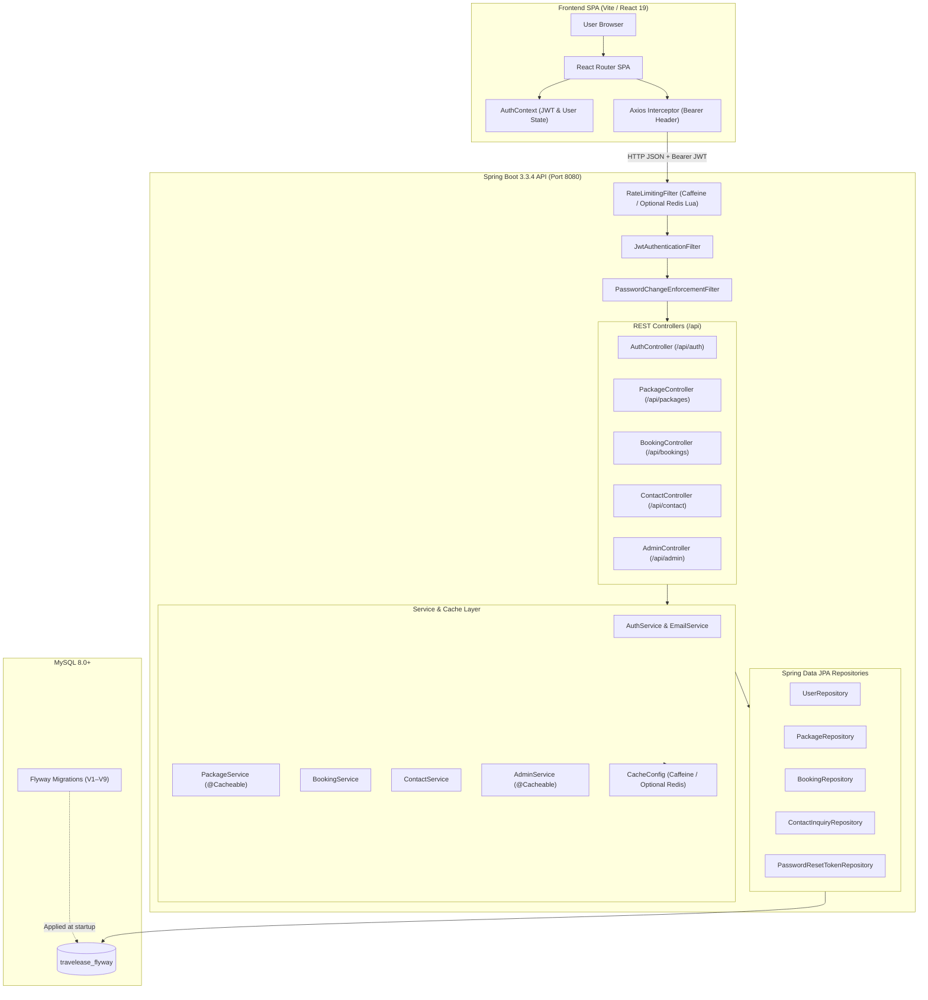

# TravelEase — Tour Package & Travel Reservation Platform

[](https://spring.io/projects/spring-boot)
[](https://react.dev/)
[](https://vitejs.dev/)
[](https://www.mysql.com/)
[](https://flywaydb.org/)
[](https://www.oracle.com/java/)
[](LICENSE)

**TravelEase** is a full-stack web application for browsing curated holiday packages across India, submitting travel reservations with server-side fare calculation, managing customer bookings and inquiries, and administering platform operations through a dedicated admin workspace.

It pairs a **React 19 (Vite 8)** single-page application with a **Spring Boot 3.3.4** REST backend using **Spring Security 6**, **JWT authentication**, **Spring Data JPA**, and **Flyway** schema migrations on **MySQL 8**.

---

## Table of Contents

- [Project Overview](#project-overview)
- [Features](#features)
  - [Customer Features](#customer-features)
  - [Administrative Features](#administrative-features)
- [Technology Stack](#technology-stack)
- [System Architecture](#system-architecture)
- [Project Directory Structure](#project-directory-structure)
- [Database Setup & Flyway Migrations](#database-setup--flyway-migrations)
- [Getting Started](#getting-started)
  - [Prerequisites](#prerequisites)
  - [Backend Setup (Windows PowerShell)](#backend-setup-windows-powershell)
  - [Frontend Setup (Windows PowerShell)](#frontend-setup-windows-powershell)
- [REST API Reference](#rest-api-reference)
- [Security Architecture](#security-architecture)
- [Caching & Rate Limiting](#caching--rate-limiting)
- [Testing & Quality Assurance](#testing--quality-assurance)
- [Load Testing & Measured Results](#load-testing--measured-results)
- [Known Limitations](#known-limitations)
- [Future Enhancements](#future-enhancements)
- [Author & License](#author--license)

---

## Project Overview

TravelEase separates public browsing, authenticated traveler workflows, and role-restricted administration behind a stateless JSON API:

- **Public Storefront**: Browse 10 seeded tour packages (Goa, Manali, Jaipur, Kerala, Ooty, Coorg, Munnar, Andaman, Rishikesh, and Udaipur) with search, price sorting, pagination, day-by-day itineraries, inclusions, and an inquiry form.
- **Reservation Workflow**: Logged-in customers create reservations where the backend calculates `totalPrice = basePrice * travelers` from persisted package prices. New reservations start in `PENDING` booking status and `PENDING` payment status. **Online payment processing is not currently integrated**; payment statuses (`PENDING`, `PAID`, `FAILED`, `REFUNDED`) are tracked manually by administrators.
- **Admin Console (`/admin`)**: Separate sidebar workspace for KPI overview cards, SQL-aggregated analytics, package CRUD and availability toggling, booking filtering and state transitions, customer account activation/deactivation, and inquiry resolution.

---

## Features

### Customer Features

- **Interactive Tour Catalog**: Browse paginated and searchable tour packages (`GET /api/packages` and `GET /api/packages/paged`) with destination metadata, duration badges, inclusions, and multi-day timelines.
- **Server-Calculated Bookings**: Reserve available tour packages (`POST /api/bookings`) with future travel date checks, traveler count validation (`>= 1`), and authoritative server-side price calculation.
- **My Bookings Dashboard**: View reservation history (`GET /api/bookings/my`), status badges, and fare breakdowns.
- **Self-Service Pending Cancellation**: Customers can cancel their own `PENDING` bookings (`PATCH /api/bookings/{id}/cancel`), transitioning them to `CANCELLED`.
- **Contact Inquiry Portal**: Publicly submit questions or custom trip requests with subjects (`POST /api/contact`).
- **Account Security & Password Flows**: Registration, login, authenticated password change modal, and single-use token password reset flow (`/forgot-password` and `/reset-password`).

### Administrative Features

- **Executive Overview & Pending Counters**: Real-time platform counts and revenue summaries (`GET /api/admin/dashboard/stats`, counting realized value strictly from `CONFIRMED` and `COMPLETED` bookings).
- **Booking Analytics**: SQL group queries for status distribution, monthly booking/revenue trends, and top 10 packages (`GET /api/admin/dashboard/analytics`).
- **Package Management**: Create, edit, toggle availability, and delete packages (deletion is blocked when existing bookings reference the package).
- **Booking Operations**: Search and filter reservations by ID, customer, package, status, or travel date range, and apply validated booking/payment status transitions.
- **Customer Directory**: Search travelers, filter by active status, inspect booking history, and activate or deactivate customer accounts (with protection against admin self-deactivation).
- **Enquiry Desk**: Search, filter, and transition contact inquiries (`NEW`, `IN_PROGRESS`, `RESOLVED`, `CLOSED`).
- **Mandatory First-Login Password Rotation**: Admin accounts flagged with `mustChangePassword=true` are restricted to `/force-password-change` until they update their temporary password.

---

## Technology Stack

### Backend

- **Framework**: [Spring Boot 3.3.4](https://spring.io/projects/spring-boot) (`Java 17` bytecode target in `pom.xml`)
- **Security & Auth**: [Spring Security 6](https://spring.io/projects/spring-security), [JJWT 0.12.5](https://github.com/jwtk/jjwt), BCrypt (`BCryptPasswordEncoder`)
- **Persistence**: [Spring Data JPA](https://spring.io/projects/spring-data-jpa), Hibernate 6 (`ddl-auto: validate`, `open-in-view: false`), HikariCP
- **Database & Migrations**: [MySQL 8.0+](https://www.mysql.com/) (`mysql-connector-j`), [Flyway](https://flywaydb.org/) (`flyway-core`, `flyway-mysql`)
- **Caching & Rate Limiting**: Caffeine (default standalone store) and optional Redis (`spring-boot-starter-data-redis`)
- **Validation & Testing**: Jakarta Bean Validation (`spring-boot-starter-validation`), JUnit 5, Mockito, Spring MockMvc, H2 (test scope)
- **Build Tool**: Apache Maven via Maven Wrapper (`mvnw`, `mvnw.cmd`)

### Frontend

- **Framework**: [React 19](https://react.dev/) (`^19.3.1`)
- **Build Tool**: [Vite 8](https://vite.dev/) (`^8.3.6`) with `@vitejs/plugin-react` (`^6.1.2`)
- **Routing**: [React Router DOM v7](https://reactrouter.com/) (`^7.18.5`)
- **HTTP Client**: [Axios](https://axios-http.com/) (`^1.21.1`) with request/response interceptors
- **Linting**: [Oxlint](https://oxc.rs/) (`^1.90.0`)
- **Styling**: Custom responsive CSS (`frontend/src/styles/main.css`), Poppins font, and Font Awesome 6 CDN icons

---

## System Architecture



---

## Project Directory Structure

```text
TravelEase/
├── backend/
│   ├── .mvn/wrapper/
│   │   └── maven-wrapper.properties
│   ├── src/
│   │   ├── main/
│   │   │   ├── java/com/travelease/
│   │   │   │   ├── TravelEaseApplication.java
│   │   │   │   ├── config/              # Security, JWT, cache, rate limit, password policy, bootstrap
│   │   │   │   ├── controller/          # Auth, Package, Booking, Contact, Admin controllers
│   │   │   │   ├── dto/
│   │   │   │   │   ├── request/         # Validated request payloads
│   │   │   │   │   └── response/        # Response & paged DTOs
│   │   │   │   ├── entity/              # JPA entities and enums
│   │   │   │   ├── exception/           # GlobalExceptionHandler & custom exceptions
│   │   │   │   ├── repository/          # Spring Data JPA repositories & aggregate queries
│   │   │   │   └── service/             # Business logic & Resend email client
│   │   │   └── resources/
│   │   │       ├── application.yml      # Spring Boot configuration with optional .env import
│   │   │       └── db/migration/        # Flyway SQL migrations V1–V9
│   │   └── test/
│   │       ├── java/com/travelease/
│   │       │   ├── TravelEaseApplicationTests.java
│   │       │   ├── config/              # CacheConfigTest, PasswordPolicyValidatorTest, RateLimitingFilterTest
│   │       │   ├── controller/          # ApiControllerTest
│   │       │   └── service/             # AuthServiceTest, BookingServiceTest, ContactServiceTest, PackageServiceTest
│   │       └── resources/
│   │           └── application-test.yml # H2 test configuration
│   ├── .env.example
│   ├── mvnw
│   ├── mvnw.cmd
│   ├── pom.xml
│   └── README.md
├── database/
│   ├── README.md                        # Phase 1 database notes
│   └── schema.sql                       # Legacy/reference SQL schema
├── frontend/
│   ├── public/
│   │   ├── favicon.svg
│   │   ├── icons.svg
│   │   └── assets/images/               # Brand logo, banners, and 10 package destinations
│   ├── src/
│   │   ├── App.jsx
│   │   ├── main.jsx
│   │   ├── api/                         # Axios client + domain API modules
│   │   ├── components/                  # Shared UI components + admin dashboard tabs
│   │   │   └── admin/
│   │   ├── context/                     # AuthContext
│   │   ├── pages/                       # Public, customer, auth, and admin pages
│   │   ├── styles/                      # main.css
│   │   └── utils/                       # passwordPolicy.js
│   ├── .env.example
│   ├── .gitignore
│   ├── .oxlintrc.json
│   ├── index.html
│   ├── package.json
│   ├── package-lock.json
│   ├── README.md
│   └── vite.config.js
├── load-tests/
│   ├── README.md
│   ├── k6-load-test.js
│   └── run_load_test.py
├── .gitignore
├── LICENSE
└── README.md
```

---

## Database Setup & Flyway Migrations

- **Active Database**: `travelease_flyway` (schema validated by Hibernate `ddl-auto: validate` and migrated automatically by Flyway at backend startup).
- **Legacy Database**: `travelease` is preserved separately as an untouched reference and is not targeted by the Spring Boot application.

### Migration Manifest (`backend/src/main/resources/db/migration/`)

| Version | File                                              | Summary                                                                                                                                                                                |
| :------ | :------------------------------------------------ | :------------------------------------------------------------------------------------------------------------------------------------------------------------------------------------- |
| **V1**  | `V1__create_users_table.sql`                      | Creates `users` with unique `email`, role constraint, `active` flag, and lookup indexes.                                                                                               |
| **V2**  | `V2__create_packages_table.sql`                   | Creates `packages` with unique `slug`, `base_price` check, and JSON `itinerary_json` / `inclusions_json`.                                                                              |
| **V3**  | `V3__create_bookings_table.sql`                   | Creates `bookings` with `ON DELETE RESTRICT` foreign keys, positive traveler/price checks, and `PENDING` defaults.                                                                     |
| **V4**  | `V4__create_contact_inquiries_table.sql`          | Creates `contact_inquiries` with workflow status constraint (`NEW`, `IN_PROGRESS`, `RESOLVED`, `CLOSED`).                                                                              |
| **V5**  | `V5__seed_initial_packages.sql`                   | Seeds the initial 4 packages: Goa, Manali, Jaipur, and Kerala.                                                                                                                         |
| **V6**  | `V6__create_payments_and_webhook_events.sql`      | Retained schema migration creating `payments` and `payment_webhook_events` tables and `bookings.confirmation_email_sent`. **Payment processing is not integrated in the application.** |
| **V7**  | `V7__create_password_reset_and_security.sql`      | Adds `users.password_changed_at` for JWT session invalidation and `password_reset_tokens` for hashed single-use reset tokens.                                                          |
| **V8**  | `V8__security_scalability_and_schema_updates.sql` | Adds `users.must_change_password`, `packages.destination`, `contact_inquiries.subject`, and composite query indexes.                                                                   |
| **V9**  | `V9__seed_expanded_packages.sql`                  | Idempotently seeds 6 additional packages: Ooty, Coorg, Munnar, Andaman, Rishikesh, and Udaipur (total 10 packages).                                                                    |

---

## Getting Started

### Prerequisites

- **Java Development Kit (JDK)**: Version 17 or newer (`java -version`)
- **Node.js & npm**: Node.js `^20.19.0` or `>=22.12.0` (required by Vite 8; check with `node -v`, `npm -v`)
- **MySQL Server**: Version 8.0+ running on port `3306`

Create the active database in MySQL before starting the backend:

```sql
CREATE DATABASE IF NOT EXISTS travelease_flyway
CHARACTER SET utf8mb4
COLLATE utf8mb4_unicode_ci;
```

### Backend Setup (Windows PowerShell)

`backend/src/main/resources/application.yml` reads environment variables and also imports an optional local `backend/.env` file (`spring.config.import: optional:file:.env[.properties]`). See `backend/.env.example` for all supported variables.

1. Open PowerShell in the backend directory and configure local environment variables (either copy `backend/.env.example` to git-ignored `backend/.env`, or export them in the terminal with placeholder values replaced):

   ```powershell
   cd D:\other\TravelEase\backend
   Copy-Item .env.example .env
   ```

   Or set them for the current PowerShell session:

   ```powershell
   $env:DB_HOST = "localhost"
   $env:DB_PORT = "3306"
   $env:DB_NAME = "travelease_flyway"
   $env:DB_USERNAME = "your_mysql_username"
   $env:DB_PASSWORD = "your_mysql_password"

   # Generate a cryptographically random 32+ byte Base64 secret for JWT signing:
   $bytes = New-Object byte[] 32
   [Security.Cryptography.RandomNumberGenerator]::Create().GetBytes($bytes)
   $env:JWT_SECRET = [Convert]::ToBase64String($bytes)

   # Optional first-run admin bootstrap (used only if no ROLE_ADMIN exists yet):
   $env:TRAVELEASE_ADMIN_USERNAME = "admin"
   $env:TRAVELEASE_ADMIN_EMAIL = "admin@example.com"
   $env:TRAVELEASE_ADMIN_PASSWORD = "YourTempOrStrongPassword1!"
   $env:TRAVELEASE_ADMIN_FORCE_PASSWORD_CHANGE = "true"
   ```

   > **Important:** The backend fails fast on startup (`JwtService.validateConfiguration()`) if `JWT_SECRET` is missing or shorter than 32 bytes. Never commit `.env` files, real passwords, or JWT signing keys.

2. Start the backend server:

   ```powershell
   cd D:\other\TravelEase\backend
   .\mvnw.cmd spring-boot:run
   ```

   The API listens on `http://localhost:8080`.

### Frontend Setup (Windows PowerShell)

1. Open a separate PowerShell terminal and start the Vite development server:

   ```powershell
   cd D:\other\TravelEase\frontend
   Copy-Item .env.example .env
   npm install
   npm run dev
   ```

2. Verify `VITE_API_BASE_URL` in `frontend/.env` points to `http://localhost:8080/api` (the default template value in `frontend/.env.example`).
3. Open the URL printed by Vite in your browser (configured default port `http://localhost:5173`; Vite may select another available port if `5173` is already occupied).

---

## REST API Reference

All endpoints are rooted at `/api`.

### 1. Authentication (`/api/auth`)

| Method | Endpoint                    | Access        | Purpose                                                                                                                                                                                                                                                                     |
| :----- | :-------------------------- | :------------ | :-------------------------------------------------------------------------------------------------------------------------------------------------------------------------------------------------------------------------------------------------------------------------- |
| `POST` | `/api/auth/register`        | Public        | Register a customer account (`ROLE_USER`), enforce password policy, and return a JWT                                                                                                                                                                                        |
| `POST` | `/api/auth/login`           | Public        | Authenticate credentials with BCrypt and return a JWT plus `mustChangePassword` flag                                                                                                                                                                                        |
| `GET`  | `/api/auth/me`              | Authenticated | Retrieve current user profile from the security context                                                                                                                                                                                                                     |
| `PUT`  | `/api/auth/change-password` | Authenticated | Verify current password, apply password policy, update BCrypt hash, clear `mustChangePassword`, and update `password_changed_at` so JWTs with an `iat` strictly earlier than `password_changed_at` are rejected (tokens issued within the same epoch second may still pass) |
| `POST` | `/api/auth/forgot-password` | Public        | Generate a SHA-256 hashed 15-minute reset token and dispatch email (returns generic response)                                                                                                                                                                               |
| `POST` | `/api/auth/reset-password`  | Public        | Validate one-time reset token, apply password policy, update hash, and update `password_changed_at` so JWTs with an `iat` strictly earlier than `password_changed_at` are rejected (tokens issued within the same epoch second may still pass)                              |

### 2. Tour Packages (`/api/packages`)

| Method   | Endpoint                          | Access | Purpose                                                                                                                         |
| :------- | :-------------------------------- | :----- | :------------------------------------------------------------------------------------------------------------------------------ |
| `GET`    | `/api/packages`                   | Public | List all available tour packages (`packages_available` cached)                                                                  |
| `GET`    | `/api/packages/paged`             | Public | Paginated, searchable, and sortable active catalog (`search`, `destination`, `maxPrice`, `page`, `size`, `sortBy`, `direction`) |
| `GET`    | `/api/packages/{id}`              | Public | Retrieve package details, itinerary JSON, inclusions, and pricing (`package_by_id` cached)                                      |
| `GET`    | `/api/packages/admin/all`         | Admin  | List all packages including unavailable ones                                                                                    |
| `POST`   | `/api/packages`                   | Admin  | Create a new tour package                                                                                                       |
| `PUT`    | `/api/packages/{id}`              | Admin  | Update package fields, itinerary, and inclusions                                                                                |
| `PATCH`  | `/api/packages/{id}/availability` | Admin  | Toggle package availability                                                                                                     |
| `DELETE` | `/api/packages/{id}`              | Admin  | Delete package when no bookings depend on it                                                                                    |

### 3. Bookings (`/api/bookings`)

| Method  | Endpoint                    | Access        | Purpose                                                                                         |
| :------ | :-------------------------- | :------------ | :---------------------------------------------------------------------------------------------- |
| `POST`  | `/api/bookings`             | Authenticated | Create a reservation (`PENDING` booking & `PENDING` payment status) with server-calculated fare |
| `GET`   | `/api/bookings/my`          | Authenticated | List bookings belonging to the authenticated user                                               |
| `GET`   | `/api/bookings/{id}`        | Authenticated | Retrieve a booking (owner or admin only)                                                        |
| `PATCH` | `/api/bookings/{id}/cancel` | Authenticated | Cancel an eligible `PENDING` booking (owner or admin)                                           |
| `GET`   | `/api/bookings`             | Admin         | List all bookings                                                                               |
| `PATCH` | `/api/bookings/{id}/status` | Admin         | Update booking status and/or payment status with validation                                     |

### 4. Customer Inquiries (`/api/contact`)

| Method  | Endpoint                   | Access | Purpose                                                                     |
| :------ | :------------------------- | :----- | :-------------------------------------------------------------------------- |
| `POST`  | `/api/contact`             | Public | Submit an inquiry with name, email, optional subject, and message           |
| `GET`   | `/api/contact`             | Admin  | List all contact inquiries                                                  |
| `PATCH` | `/api/contact/{id}/status` | Admin  | Update inquiry workflow status (`NEW`, `IN_PROGRESS`, `RESOLVED`, `CLOSED`) |

### 5. Administration (`/api/admin`)

| Method  | Endpoint                           | Access | Purpose                                                                                               |
| :------ | :--------------------------------- | :----- | :---------------------------------------------------------------------------------------------------- |
| `GET`   | `/api/admin/dashboard/stats`       | Admin  | KPI summary (`admin_dashboard_stats` cached)                                                          |
| `GET`   | `/api/admin/dashboard/analytics`   | Admin  | SQL-aggregated status distribution, monthly booking/revenue trends, and top packages                  |
| `GET`   | `/api/admin/bookings`              | Admin  | Filtered & paginated bookings (`status`, `packageId`, `fromDate`, `toDate`, `search`, `page`, `size`) |
| `PATCH` | `/api/admin/bookings/{id}/status`  | Admin  | Validated booking and/or payment status transition                                                    |
| `GET`   | `/api/admin/customers`             | Admin  | Filtered & paginated customer accounts with booking counts                                            |
| `GET`   | `/api/admin/customers/{id}`        | Admin  | Customer profile summary and booking history                                                          |
| `PATCH` | `/api/admin/customers/{id}/status` | Admin  | Activate or deactivate a customer account                                                             |
| `GET`   | `/api/admin/enquiries`             | Admin  | Filtered & paginated contact inquiries                                                                |
| `PATCH` | `/api/admin/enquiries/{id}/status` | Admin  | Update contact inquiry status                                                                         |

---

## Security Architecture

- **Stateless JWT Authentication**: `SecurityConfig` configures `SessionCreationPolicy.STATELESS`. `JwtService` enforces a minimum 32-byte signing key at startup (`@PostConstruct`) and validates tokens on every request via `JwtAuthenticationFilter`.
- **BCrypt Password Hashing**: Passwords are hashed using `BCryptPasswordEncoder` and never returned in API responses or logs.
- **Role-Based Access Control (RBAC)**: Public registration always assigns `ROLE_USER`. `/api/admin/**`, `/api/packages/admin/**`, and administrative mutation routes enforce `ROLE_ADMIN` in both `SecurityConfig` and `@PreAuthorize` annotations.
- **Consistent Password Policy**: Enforced identically across registration, authenticated password change, password reset (`PasswordPolicyValidator`), and frontend forms (`frontend/src/utils/passwordPolicy.js`):
  - Minimum `8` characters and maximum `128` characters
  - At least one uppercase letter (`A–Z`)
  - At least one lowercase letter (`a–z`)
  - At least one number (`0–9`)
  - At least one special character (non-alphanumeric, non-whitespace)
  - No leading or trailing whitespace
- **Forced Admin Password Rotation**: When `AdminBootstrapper` creates or resets an admin account with `TRAVELEASE_ADMIN_FORCE_PASSWORD_CHANGE=true` or a non-compliant password (outside `prod`), `users.must_change_password` is set to `true`. `PasswordChangeEnforcementFilter` returns HTTP `403` for protected routes until `/api/auth/change-password` succeeds; `ProtectedRoute` and `AdminRoute` route those users to `/force-password-change`. (In `prod` profile, `AdminBootstrapper` rejects non-compliant bootstrap passwords on startup.)
- **JWT Session Invalidation**: Password changes and resets update `users.password_changed_at`, causing `JwtAuthenticationFilter` to reject JWTs whose `iat` (epoch seconds) is strictly earlier than `password_changed_at` (epoch seconds). Because comparison uses whole-second precision (`tokenIssuedAtSeconds < changedAtSeconds`), tokens issued in earlier seconds are rejected while a token issued within the exact same second would still pass this check.
- **Single-Use Password Reset Tokens**: `AuthService.forgotPassword` generates a 32-byte `SecureRandom` hex token, stores only its SHA-256 hash (`password_reset_tokens.token_hash`) with a 15-minute expiry, invalidates prior pending tokens, and always returns a generic response to prevent account enumeration.
- **Server-Side Booking Price Calculation**: `BookingService` calculates `totalPrice` solely from the database package `base_price` and traveler count, ignoring any client-supplied totals.
- **Database Integrity Constraints**: `bookings.user_id` and `bookings.package_id` use `ON DELETE RESTRICT`, preventing deletion of accounts or packages with booking history.
- **Trusted Proxy Handling & Rate Limiting**: `RateLimitingFilter` extracts forwarded client IPs from `X-Forwarded-For` (right-to-left skipping trusted hops) **only** when the peer socket address matches `RATE_LIMIT_TRUSTED_PROXIES` (empty by default, so direct clients cannot spoof `X-Forwarded-For` to bypass limits).

---

## Caching & Rate Limiting

- **Application Caching (`CacheConfig`)**:
  - **Default (`CACHE_TYPE=caffeine`)**: Bounded in-memory Caffeine caches (`packages_available`, `package_by_id`, `admin_dashboard_stats`) with `maximumSize(1000)` and 10-minute write TTL. Cache eviction occurs on package CRUD/availability changes, booking creation/cancellation/status updates, inquiry submission/status updates, customer status toggles, and successful user registration.
  - **Optional Redis (`CACHE_TYPE=redis`)**: Configured with `RedisCacheManager` using a cache-specific Jackson `ObjectMapper` (`JavaTimeModule` + strict `BasicPolymorphicTypeValidator` allowlist) so `PackageResponse` (`LocalDateTime` and `JsonNode`), `List<PackageResponse>`, and `AdminStatsResponse` round-trip safely.
- **Rate Limiting (`RateLimitingFilter`)**:
  - **Default limits (per minute per client IP)**: `20` on `POST /api/auth/login`, `10` on `POST /api/auth/register`, `10` on `/api/auth/forgot-password` and `/api/auth/reset-password`, `10` on `POST /api/contact`, and `600` across other `/api/**` routes. Exceeding a limit returns HTTP `429 Too Many Requests` with `Retry-After: 60`.
  - **Optional Redis Store (`RATE_LIMIT_STORE=redis`)**: Uses an atomic Lua script (`INCR` + conditional `EXPIRE` on creation + `TTL == -1` repair) via `StringRedisTemplate`, falling back safely to local Caffeine counters if Redis is unavailable.
- **Live Redis Verification Status**: Redis cache serialization (`CacheConfigTest`) and atomic Lua rate-limit execution (`RateLimitingFilterTest` with mocked `StringRedisTemplate`) are covered by **unit tests only**. Live integration against a running Redis server has not yet been executed.

---

## Testing & Quality Assurance

### Backend Tests (`H2` Test Profile)

Run unit and Spring Boot MockMvc integration tests:

```powershell
cd D:\other\TravelEase\backend
.\mvnw.cmd clean test
```

_(In `backend/src/test/resources/application-test.yml`, Flyway and `RateLimitingFilter` are disabled and Hibernate runs `create-drop` against in-memory H2 in MySQL mode.)_

**Verified Test Suite (61 tests total across 9 test classes):**

- `CacheConfigTest` (4 unit tests): `PackageResponse`, `List<PackageResponse>`, `AdminStatsResponse` serialization/deserialization (`LocalDateTime`, `JsonNode`) and untrusted `@class` gadget rejection.
- `PasswordPolicyValidatorTest` (9 unit tests): 8–128 length bounds, whitespace rejection, uppercase/lowercase/number/special character enforcement, and confirmation that simplified valid passwords pass.
- `RateLimitingFilterTest` (5 unit tests): Direct `X-Forwarded-For` spoofing prevention, right-to-left trusted-proxy IP extraction, atomic Redis Lua script invocation, HTTP `429` enforcement, and Caffeine fallback on Redis error.
- `ApiControllerTest` (12 Spring Boot MockMvc integration tests): Auth register/login, public package endpoints, booking auth & server-side fare math, user isolation, admin RBAC, forced admin password change flow, dashboard cache eviction on successful registration, empty `{}` booking status `400` validation, booking status transition guards, and consistent simplified password policy across registration, change-password, reset-password, forced admin change, and legacy user login.
- `AuthServiceTest` (17 Mockito unit tests), `BookingServiceTest` (9 Mockito unit tests), `ContactServiceTest` (1 unit test), `PackageServiceTest` (3 unit tests), and `TravelEaseApplicationTests` (1 context load test).

### Frontend Lint & Production Build

```powershell
cd D:\other\TravelEase\frontend
npm run lint
npm run build
```

- `npm run lint` executes `oxlint` (last run reported 0 errors and 12 pre-existing warnings in `AuthContext.jsx` and initial `useEffect` data-fetch hooks).
- `npm run build` compiles and bundles the Vite production build into `frontend/dist/`.
- Automated frontend unit or browser E2E test suites (e.g., Vitest/Playwright) are not configured in `frontend/package.json`.

---

## Load Testing & Measured Results

The `load-tests/` directory contains two read-oriented concurrency scripts:

- `load-tests/run_load_test.py`: Zero-dependency Python `http.client` multi-threaded runner targeting `GET /api/packages`, `GET /api/packages/paged?page=0&size=9`, `GET /api/packages/{1..10}`, plus optional authenticated `GET /api/bookings/my` and `GET /api/admin/dashboard/stats`.
- `load-tests/k6-load-test.js`: k6 staged ramp-up script exercising the same read-only endpoints.

### Previously Reported Local Read-Heavy Benchmark

Recorded locally against the Caffeine-cached backend over 15-second runs on `http://localhost:8081` using `load-tests/run_load_test.py` (with the general per-minute rate limit raised for single-host loopback concurrency):

| Virtual Users | Total Requests |     Throughput | Average Latency | Median (P50) | P95 Latency | P99 Latency |    Errors |
| ------------: | -------------: | -------------: | --------------: | -----------: | ----------: | ----------: | --------: |
|           200 |         72,314 | 4,809.75 req/s |        34.55 ms |     29.79 ms |    75.88 ms |   112.58 ms | 0 (0.00%) |
|           500 |         83,492 | 5,534.19 req/s |        57.02 ms |     46.78 ms |   139.88 ms |   200.11 ms | 0 (0.00%) |

**Important Notes:**

- These figures reflect a **local single-machine, read-heavy `GET` benchmark** dominated by cached catalog and dashboard responses — **not** guaranteed production capacity or a full write/checkout workload (`POST /api/bookings` and sustained `POST /api/auth/login` concurrency were not measured by this harness).
- **10,000 concurrent virtual users were not tested.**

---

## Known Limitations

- **No Payment Gateway Integration**: Online checkout (such as Razorpay or Stripe) is not integrated. Reservations stay in `PENDING` payment status until updated manually by an administrator.
- **Email Delivery Requires Resend API Key**: If `EMAIL_API_KEY` (`RESEND_API_KEY`) is unset or blank, `EmailService` simulates booking confirmation and password reset email dispatches in application logs instead of sending real emails.
- **Live Redis Server Unverified**: `CACHE_TYPE=redis` and `RATE_LIMIT_STORE=redis` are verified only via unit tests and mocked Redis templates, not against a live Redis instance.
- **H2 vs MySQL Test Gap**: Automated backend tests run against H2 with Flyway disabled rather than live MySQL; Flyway V1–V9 SQL compatibility is validated separately against MySQL.
- **No Automated Frontend E2E Suite**: Frontend behavior beyond static linting and Vite bundling relies on manual/browser inspection rather than a repeatable Playwright/Vitest test suite.

---

## Future Enhancements

- Integrate a payment gateway with webhook signature and capture verification before confirming paid bookings.
- Execute live Redis integration tests for distributed caching and multi-node Lua rate limiting.
- Add MySQL Testcontainers coverage to run Flyway V1–V9 and native queries in CI.
- Add automated frontend unit and Playwright end-to-end tests in `frontend/`.
- Expand load-testing scenarios to benchmark mixed write traffic (`POST /api/bookings`) and concurrent login traffic.

---

## Author & License

**Developed by Anil N**

- **GitHub**: [@Anil-42](https://github.com/Anil-42)
- **Repository**: [https://github.com/Anil-42/TRAVELEASE](https://github.com/Anil-42/TRAVELEASE)

This project is licensed under the [MIT License](LICENSE).
